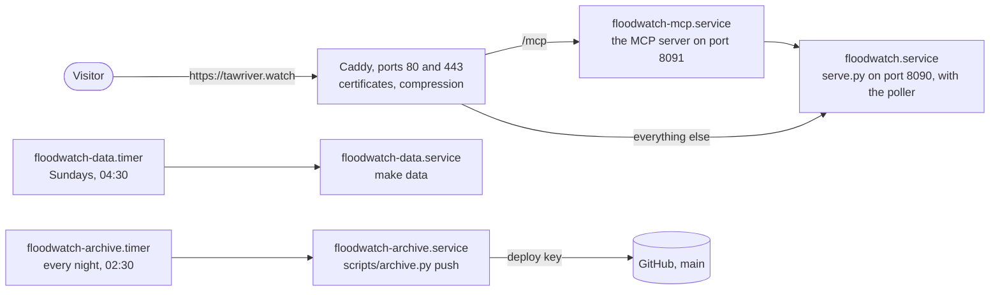
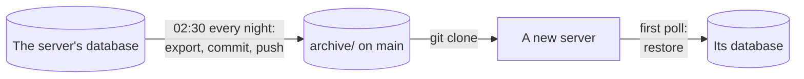
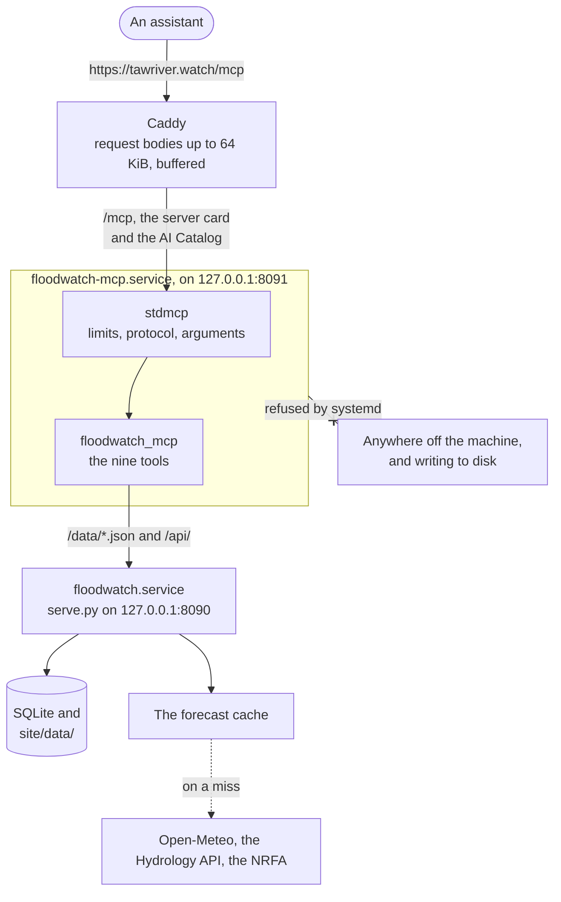
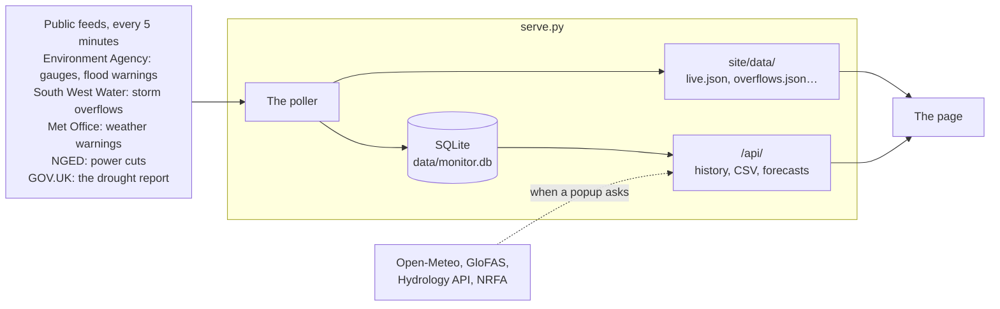
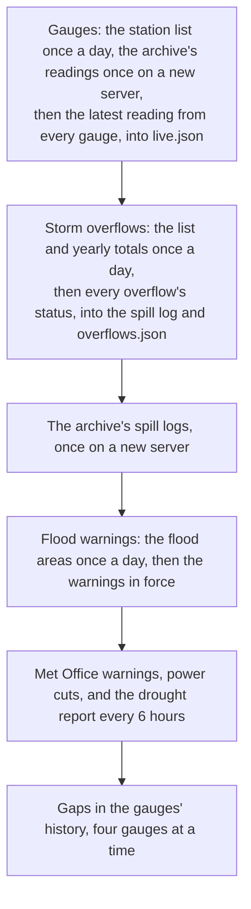
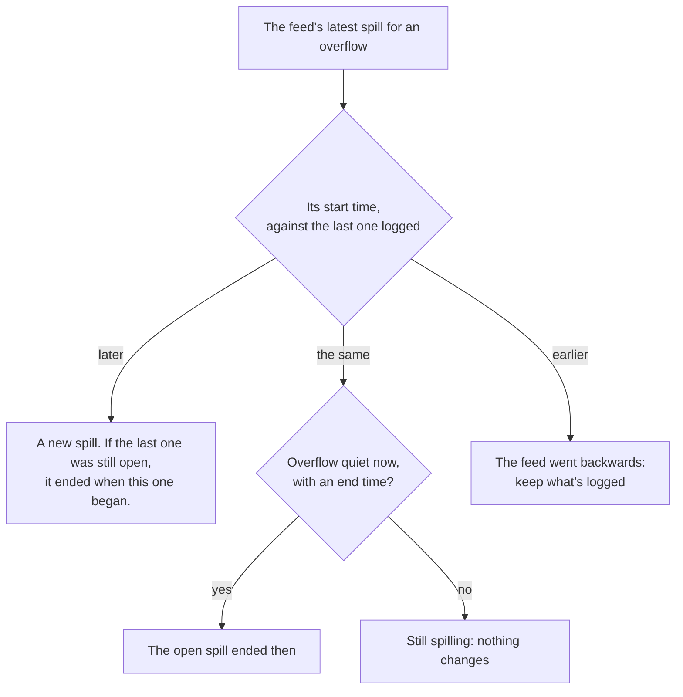

# Floodwatch

![Floodwatch in a Safari window, on its Map tab beside Agents and About: the River Taw catchment in north Devon, with river level gauges as teal circles showing their readings in metres, rain gauges as drops, storm overflows spilling now as dark purple dots, clusters of gauges as white circles with a count, the rivers in their own colours, Exmoor and Dartmoor shaded pale green, the Tarka and Dartmoor lines, the drought and flood warning tags in the header, and the layers legend open at the bottom left](docs/screenshot.png)

Floodwatch shows what the River Taw is doing: how high each gauge is and whether it's rising, how much rain has fallen in the last hour, which storm overflows are spilling, and what flood and weather warnings are in force across the catchment, from Dartmoor to Barnstaple. It runs at [tawriver.watch](https://tawriver.watch).

Everything on the map is public data, from the Environment Agency, South West Water, the Met Office, National Grid Electricity Distribution, and others, read every five minutes. The Environment Agency's API holds about four weeks of readings, and South West Water's feed holds only each overflow's latest spill. Floodwatch keeps its own copy of every reading since 13 January 2026 and every spill since 3 June 2026, and serves the lot.

The site is one page with no framework and no build step. The server, the poller, and the map-data builder use only the Python standard library, with readings kept in SQLite.

- [What the map shows](#what-the-map-shows)
- [Data sources](#data-sources)
- [Running it](#running-it), locally and on a server
- [The archive](#the-archive)
- [The MCP server](#the-mcp-server), for AI assistants
- [How it works](#how-it-works)
- [Tests](#tests), [project layout](#project-layout), [contributing](#contributing), and [licence](#licence)

## What the map shows

### Gauges

The Environment Agency's gauges are the map's main layer, each with its latest reading printed on it.

| Marker | Reading | Colour |
|---|---|---|
| Circle | River level, in metres | Teal; amber once within 30% of the top of the gauge's typical range; red above it |
| Diamond | Tidal level at Barnstaple, in metres above Ordnance Datum | Orange |
| Drop | Rain in the last hour, in millimetres | Blue; a small pale drop with no number when it hasn't rained |

![The River Mole at Woodleigh from 30 October to 27 November 2026. The level stayed between 0.4 and 0.8 m until 16 November, rose to 1.5 m on the 17th and to 2.06 m on the 20th, and fell back below 1.19 m on the 22nd. The band from 1.19 m, 70% of the 1.70 m top of the gauge's typical range, is shaded amber, and the band above 1.70 m red. A strip under the chart shows the marker teal, then amber for most of the 17th, then amber from the 19th, red from that evening to the evening of the 20th, and amber again until the 22nd; the level then fell steadily, to 0.73 m by the 27th](docs/gauge-states.svg)

The River Mole at Woodleigh in November 2026, with the marker's colour at each reading.

River and tidal gauges carry a badge with an arrow when the level is rising, falling, or steady, from a straight line fitted to the last hour's readings; a change of less than 1 cm an hour counts as steady. A gauge that has sent nothing for three hours turns grey and smaller, and loses its badge.

Gauges that would overlap on screen are gathered into a white circle with a count until zoom 13. Its edge takes the most urgent level among them, amber or red. It has a blue ring if any rain gauge among them has had rain in the last hour, and a rising badge if any river or tidal gauge among them is rising. Hovering lists each gauge and its reading, and clicking zooms in.

Clicking a gauge opens its chart for the last 24 hours, 7 days, 28 days, or all time. Over all time each point is the highest level, or the total rain, in an hour or more, so a flood isn't averaged away. River charts mark the top of the typical range and the record high. Rain gauges add the next 48 hours of forecast rain. The gauge at Umberleigh adds a fortnight's river flow forecast for the Taw, set against the flow measured there. Every gauge's popup links to a CSV of every reading it has.

The map shows the gauges inside the catchment, and the rain gauges up to 2 km over its watershed, such as Kinsford Gate on Exmoor, since rain falling there runs into the Taw.

### Storm overflows

South West Water's storm overflows in the catchment release storm sewage into the rivers and the estuary when heavy rain overloads the sewers. Each is a purple dot, larger at a sewage treatment works than on the sewer network or at a pumping station.

| Dot | Meaning | Shown |
|---|---|---|
| Dark purple, with a halo | Spilling now | When the page opens |
| Mid purple | Spilled in the last 48 hours | Once switched on in the legend |
| Pale purple | No spill in the last 48 hours | Once switched on, from zoom 11 |
| Hollow grey | Monitor offline | Once switched on, from zoom 11 |

An overflow's popup shows its spills over the last 30 days and its spill hours and count for each year from the regulatory annual returns. South West Water's names are spelt out: "Chulmleigh WWTW SSO" is Chulmleigh wastewater treatment works' settled storm overflow.

### Warnings

While the Environment Agency has a flood warning or alert in force in the catchment, a bar under the header says so, giving the area's name when there's one and a count by severity when there are more. Opening it lists each with the Agency's message and a "Show on map" button. A warning's area is outlined on the map; an alert covers a wide area, so its area is a faint tint. While nothing is in force, a green tag in the header says so.

The Met Office's yellow, amber, and red warnings that name Devon get a bar of their own, in the warning's colour.

### Drought and power cuts

A tag in the header gives the Environment Agency's drought status for its Devon, Cornwall and Isles of Scilly area, from its weekly report, and South West Water's hosepipe ban when there is one. The report words some stages by reservoir, so the tag opens to show each one as written.

National Grid Electricity Distribution's power cuts in the catchment are dark discs with a yellow bolt, larger the more customers are off. Each popup gives the customers off and back on, when power is expected back, and the postcodes affected.

### Background

The rivers come from OpenStreetMap. Eight of them are drawn in their own colours and named: the Taw, the Mole, the River Bray, the Little Dart, the River Yeo through Barnstaple, the Lapford Yeo, the Crooked Oak, and Hollocombe Water. The catchment's other rivers are pale blue and named on hover, and so are the streams the Environment Agency gauges, such as Landkey Brook at Swimbridge, so no gauge sits on nothing; the rest of the streams can be switched on from zoom 12. Rivers end where they meet the estuary rather than running down the middle of it, and the Taw runs on through its tidal reach to Barnstaple's Long Bridge. Dartmoor and Exmoor, where the Taw and its eastern tributaries rise, are shaded pale green and named.

The Tarka Line runs from Barnstaple into Exeter St Davids and Exeter Central, with the Dartmoor Line off it to Okehampton. The A377 and the A30 west of Exeter are the only roads drawn, and the catchment's outline can be switched on from the legend.

The page follows the system's light or dark setting, with a toggle to override it.

## Data sources

| Data | Source | Read | Licence |
|---|---|---|---|
| River, tidal, and rain gauges | Environment Agency [real-time flood-monitoring API](https://environment.data.gov.uk/flood-monitoring/doc/reference) | Every 5 minutes | [Open Government Licence](https://www.nationalarchives.gov.uk/doc/open-government-licence/version/3/) |
| Flood warnings and alerts, and their areas | The same API | Every 5 minutes | Open Government Licence |
| Storm overflows | South West Water's [storm overflow activity feed](https://www.arcgis.com/home/item.html?id=cabfce76b72a4a278a33d737c0708d42) | Every 5 minutes | [CC BY 4.0](https://creativecommons.org/licenses/by/4.0/) |
| Storm overflow names, types and yearly totals | Event Duration Monitoring [annual returns](https://www.arcgis.com/home/item.html?id=66fef44a4aab438991d7ce08fbc1de64) | Daily | Open Government Licence |
| Weather warnings | Met Office [weather warnings](https://weather.metoffice.gov.uk/warnings-and-advice/uk-warnings) for South West England | Every 5 minutes | [Met Office terms](https://www.metoffice.gov.uk/policies/tandc) |
| Drought status and hosepipe bans | Environment Agency's weekly [Dry weather and drought in England](https://www.gov.uk/government/publications/dry-weather-and-drought-in-england-2026-summary-reports) report, through the [GOV.UK Content API](https://content-api.publishing.service.gov.uk/) | Every 6 hours | Open Government Licence |
| Power cuts | NGED's [live power cuts](https://connecteddata.nationalgrid.co.uk/dataset/live-power-cuts) | Every 5 minutes | [NGED Open Data Licence](https://www.nationalgrid.co.uk/open-data-licence) |
| Rain forecast | [Open-Meteo](https://open-meteo.com/) weather forecast API | When a popup asks, kept 15 minutes | CC BY 4.0 |
| River flow forecast | GloFAS, from the Copernicus Emergency Management Service, through Open-Meteo's [flood API](https://open-meteo.com/en/docs/flood-api) | When a popup asks, kept an hour | CC BY 4.0 |
| Measured river flow | Environment Agency [Hydrology API](https://environment.data.gov.uk/hydrology/doc/reference) | When a popup asks, kept 15 minutes | Open Government Licence |
| Mean river flow | UK [National River Flow Archive](https://nrfa.ceh.ac.uk/) | When needed, kept a week | [NRFA terms](https://nrfa.ceh.ac.uk/help/costs-terms-and-conditions) |
| Catchment boundary | Environment Agency [WFD operational catchments](https://services3.arcgis.com/Bb8lfThdhugyc4G3/ArcGIS/rest/services/WFD_Surface_Water_Operational_Catchments_Cycle3/FeatureServer) and the [Catchment Data Explorer](https://environment.data.gov.uk/catchment-planning/)'s river water bodies | Weekly | Open Government Licence |
| Rivers, streams, railways, stations, roads and place names | [OpenStreetMap](https://www.openstreetmap.org/), through the Overpass API | Weekly | [ODbL](https://www.openstreetmap.org/copyright) |
| Basemap | Esri World Light Gray and Dark Gray Canvas | Loaded by the page | [Esri terms](https://www.esri.com/en-us/legal/terms/full-master-agreement) |

## Running it

### Locally

You'll need Python 3.10 or later, `make`, `curl`, and `shasum`, and Node 22 or later for the JavaScript tests.

```bash
git clone https://github.com/aallan/floodwatch.git
cd floodwatch
make libs     # download Leaflet and Leaflet.markercluster into site/lib, and check them against libs.sha256
make data     # build the map overlays in site/data
make serve    # serve the site at http://localhost:8090, polling every 5 minutes
```

The first poll lists the gauges and loads their readings from `archive/`, lists the storm overflows and loads their spill logs, reads the warnings, the power cuts, and the drought report, and then fetches from the Environment Agency whatever the archive doesn't hold, four gauges at a time. The Agency can take a minute or more to answer for its station list the first time it's asked, so the gauges appear within a few minutes, and the history fill takes a few more.

`make data` takes a few minutes on a first run, most of it waiting on the public [Overpass API](https://wiki.openstreetmap.org/wiki/Overpass_API) servers, and the builder tries up to eight times, across two of them, when they're busy. Downloads are cached in `.cache/overpass/` for a day; when Overpass is slow, a copy of another machine's `.cache/overpass/` and `--cached` gets round it:

```bash
python3 scripts/fetch_geodata.py --refresh   # ignore the cache and download everything again
python3 scripts/fetch_geodata.py --cached    # rebuild from the cache, however old
```

The other targets:

```bash
make poll     # run one poll of every feed, without the server
make test     # run the Python and JavaScript tests
make og       # redraw the link preview card, site/img/og-image.png (needs Google Chrome and make data)
make figures  # redraw the figures in docs/ (needs make data, and reads the live site for the flow forecast and the gauge states)
make screenshot  # retake docs/screenshot.png, the map in a Safari window, from the running server (needs Google Chrome and Node)
make mcp      # serve the MCP server at http://localhost:8091/mcp, reading from make serve
make clean    # remove the libraries, overlays and download cache; the database stays
```

### On a server

The public site runs on a small Ubuntu 24.04 droplet, with [Caddy](https://caddyserver.com/) in front for HTTPS. The site is one process and the MCP server another, and every night the server pushes the archive back to this repository.



`deploy/` holds the configuration:

```
deploy/floodwatch.service           the web server and poller
deploy/floodwatch-data.service      rebuilds the map overlays, giving up after an hour
deploy/floodwatch-data.timer        runs that rebuild early every Sunday
deploy/floodwatch-archive.service   exports the archive, commits it and pushes it, giving up after 30 minutes
deploy/floodwatch-archive.timer     runs that at 02:30 every night
deploy/floodwatch-mcp.service       the MCP server, sandboxed
deploy/Caddyfile                    HTTPS for tawriver.watch, the route to the MCP server, and the redirect from www
```

As root on the new server, install Caddy and make the `floodwatch` user, whose home is the checkout, with an SSH key of its own:

```bash
apt update && apt install -y git make curl gnupg python3 debian-keyring debian-archive-keyring apt-transport-https
curl -1sLf https://dl.cloudsmith.io/public/caddy/stable/gpg.key | gpg --dearmor -o /usr/share/keyrings/caddy-stable-archive-keyring.gpg
curl -1sLf https://dl.cloudsmith.io/public/caddy/stable/debian.deb.txt > /etc/apt/sources.list.d/caddy-stable.list
apt update && apt install -y caddy

useradd --system --home-dir /srv/floodwatch --shell /usr/sbin/nologin floodwatch
install -d -o floodwatch -g floodwatch -m 750 /srv/floodwatch /srv/floodwatch/.ssh
runuser -u floodwatch -- ssh-keygen -t ed25519 -N '' -C floodwatch-archive -f /srv/floodwatch/.ssh/id_ed25519
cat /srv/floodwatch/.ssh/id_ed25519.pub
```

Add that public key to the repository as a deploy key, under **Settings → Deploy keys**, with write access. The nightly archive pushes straight to `main`, so the key also has to be allowed past `main`'s protection. A classic branch protection rule can't exempt a deploy key, so `main` is protected by a repository ruleset instead. It requires a pull request and the `python-tests` and `js-tests` checks, blocks force pushes and deletion, and lists **Deploy keys** and **Repository admin** as always allowed to bypass it.

Then fetch the code into the user's home, which already holds `.ssh/` (ignored by git), build, and start everything:

```bash
runuser -u floodwatch -- ssh -o StrictHostKeyChecking=accept-new -T git@github.com   # records GitHub's host key
cd /srv/floodwatch
runuser -u floodwatch -- git init -q -b main .
runuser -u floodwatch -- git remote add origin git@github.com:aallan/floodwatch.git
runuser -u floodwatch -- git fetch -q origin
runuser -u floodwatch -- git checkout -q -t origin/main
runuser -u floodwatch -- make libs
runuser -u floodwatch -- make data

cp deploy/*.service deploy/*.timer /etc/systemd/system/
systemctl daemon-reload
systemctl enable --now floodwatch floodwatch-mcp floodwatch-data.timer floodwatch-archive.timer
cp deploy/Caddyfile /etc/caddy/Caddyfile
systemctl reload caddy

ufw allow OpenSSH && ufw allow 80/tcp && ufw allow 443 && ufw --force enable
```

Watch the first poll with `journalctl -u floodwatch -f`, where the archive restore reports how many readings and spills it loaded. Before anyone else sees it, look at the site through an SSH tunnel from your own machine, `ssh -L 8092:localhost:8090 root@<server>`, at http://localhost:8092.

Then point the domain at the server: A and AAAA records for the bare name and for `www`, or for a `*` wildcard, which covers `www`. Caddy fetches its certificates once Let's Encrypt can reach the server by name; if it tried before the DNS changed, it waits longer after each failure, and `systemctl restart caddy` makes it try again straight away. After any change to the Caddyfile, check it on the server before reloading: `caddy validate --config /etc/caddy/Caddyfile --adapter caddyfile`.

The web service runs as the unprivileged `floodwatch` user and can write only to `data/`, `site/data/`, and `.cache/`; the archive service writes only to `data/` and `.git`; the MCP server writes nowhere. Their logs are in the journal, `journalctl -u floodwatch`, `journalctl -u floodwatch-mcp`, and `journalctl -u floodwatch-archive`. The archive keeps the data; a nightly backup from the hosting provider keeps the rest, Caddy's certificates and the deploy key among it.

To update, pull and restart. The header shows the version `git describe` gives when the server starts, and the first poll after a restart reads every feed straight away, whatever its schedule:

```bash
cd /srv/floodwatch && runuser -u floodwatch -- git pull && systemctl restart floodwatch floodwatch-mcp
```

A server set up before the MCP server existed needs it added once, after the pull: `cp deploy/floodwatch-mcp.service /etc/systemd/system/`, `systemctl daemon-reload`, `systemctl enable --now floodwatch-mcp`, `cp deploy/Caddyfile /etc/caddy/Caddyfile`, `caddy validate --config /etc/caddy/Caddyfile --adapter caddyfile` and `systemctl reload caddy`.

## The archive

`archive/` holds every reading and spill Floodwatch has, in the CSV format v1 published:

- `stations.csv`, one row per gauge, with the series from which its readings come
- `level_<id>_<name>.csv` and `rainfall_<id>.csv`, one per gauge, with every 15-minute reading: `dateTime,value,unit,station_id,station_label`
- `cso_<id>.csv`, one per storm overflow, with every spill: `start_time,end_time,duration_min,is_ongoing`



Every night `scripts/archive.py push` writes the database out to `archive/`, and commits and pushes the files that changed, as the author "Floodwatch archive". It works in a separate git worktree, `data/archive-worktree`, reset to the tip of `main` each night, so the checkout the server runs from is never touched and a deploy's `git pull` stays a fast-forward; if a push fails, the next night starts afresh. Each gauge's file is reused and written the same way every night, so a night's commit adds that day's lines and nothing else, and the test workflow skips commits that only touch `archive/`. Files of gauges that are no longer listed are left alone.

The first export rewrote the files v1 left, once, in v2's format. v2 records spill times to the second, where v1 kept fractions of one, rounds spill durations to the nearest minute, labels Barnstaple's tidal gauge "Barnstaple", and sorts `stations.csv` by ID. The readings and spills themselves didn't change.

On a new server the first poll loads the archive's readings as soon as the gauges are listed, before it stores the latest, and its spill logs once the overflows are listed, however many cycles that takes. Readings and spills it already holds are kept, so the load is safe to repeat; `python3 scripts/archive.py restore` runs it by hand, and loads v1's own `data/` directory too. Station and overflow IDs are checked against a strict pattern before they become file names, when exporting and when restoring.

## The MCP server

Floodwatch has an MCP server, for AI assistants such as Claude. [MCP](https://modelcontextprotocol.io/) is a standard way for an assistant to look things up from a service instead of guessing. One connected to Floodwatch can answer questions about the Taw's gauges, rain, storm overflows, warnings, drought, and power cuts from the same data as the map. It is read-only and free, and needs no sign-in. Its address is `https://tawriver.watch/mcp`. The site's Agents tab (`#/agents`) says the same to visitors.

It has nine tools:

| Tool | What it gives |
|---|---|
| `list_stations` | Every river level, tidal, and rain gauge, with its ID, kind, river, and location |
| `conditions` | The latest reading, trend and state at each gauge, as the map shows them |
| `flood_warnings` | Environment Agency flood warnings and alerts, and Met Office weather warnings for Devon |
| `station_history` | One gauge's readings over the past days, with its typical range and record high |
| `rain_forecast` | Forecast rain, hour by hour, for the next 48 hours at a rain gauge |
| `flow_forecast` | Modelled river flow for the past week and the fortnight ahead, at gauges that have one |
| `storm_overflows` | Which storm overflows are spilling, and one overflow's spills over the past 30 days |
| `drought` | The latest drought report for the area and any hosepipe bans |
| `power_cuts` | Live power cuts, with customers off and the estimated time back on |

In Claude, add it as a custom connector: Customize, then Connectors, then Add, then Add custom connector, paste the address, and choose no sign-in. To use it from Dispatch, set the connector's tools to Always allow because Dispatch leaves out a connector whose tools ask first. In Claude Code:

```bash
claude mcp add --transport http floodwatch https://tawriver.watch/mcp
```

Software can find it without being told. `/.well-known/ai-catalog.json` points to the server card at `/mcp/server-card`. The card describes the server and gives the endpoint's address. `/llms.txt` explains the site in plain text, and `/robots.txt` lets crawlers read all of it.

It runs as its own process, `floodwatch-mcp.service`, on 127.0.0.1:8091, with Caddy sending `/mcp` and the two discovery paths to it and everything else to the web server. It reads only the website's own JSON files and API on 127.0.0.1:8090, so it holds no data of its own and polls no feed. systemd confines it: `IPAddressDeny=any` with `IPAddressAllow=localhost` leaves it able to reach nothing but the machine itself, it has no writable paths, and it is limited to 96 MB of memory, 30% of a CPU, and 32 tasks.



Each address can make 300 requests a minute, in bursts of up to 60, the server as a whole 600 a minute, and no more than 8 can run at once. Over the rate limits it answers 429; over 8 at once it answers 503. Both carry a `Retry-After` header.

To run it locally, start the site, then the MCP server beside it. Point an assistant at `http://localhost:8091/mcp`:

```bash
make serve   # the site and its API, on port 8090
make mcp     # the MCP server, on port 8091, reading from it
```

The transport is a separate package, `stdmcp/`, which uses only the standard library and imports nothing from Floodwatch. It can be copied into another project; its [README](stdmcp/README.md) says what it does and does not do. `floodwatch_mcp/` holds Floodwatch's side: the nine tools and how they read the site.

## How it works



The whole site is one Python process. The poller, in `monitor/`, runs in a thread of `serve.py` every 5 minutes, reads the feeds into SQLite, and writes the small JSON files the page loads when it opens. Everything bigger, a gauge's history, a CSV, a forecast, is fetched from `/api/` only when a popup asks for it.



Each step fails on its own, so one feed being down doesn't stop the others, and a failing daily refresh of a list doesn't stop the live readings that use it, which carry on against yesterday's list while the refresh is tried again next cycle. A request that's cut off or reset is tried again, and every request gives up after two minutes, however slowly an answer arrives.

### The catchment


Two Environment Agency datasets make the catchment's outline. The WFD operational catchment "Taw and North Devon Streams" covers all the land draining to the Taw, Barnstaple included, and stops at the estuary's banks; but it also takes in the Exmoor coast, from Croyde round to Lynmouth. The river water bodies inside it are numbered by hydrometric area, and those draining to the Taw are in area 50, the same as the gauging station at Umberleigh; but they leave out the land draining straight into the estuary. The outline is the operational catchment wherever it's in one of the Taw's water bodies or in a box round the estuary, about 1,200 km². The two datasets were digitised separately, so they're combined on a grid about 5 m square and the outline traced from it.

The same builder writes the catchments around the Taw's: the Torridge, Barnstaple Bay, the Exmoor coast, and the rest. Gauges, storm overflows, power cuts, and flood areas belong to the catchment when they're inside it, or near it and nearer to it than to any of those, which takes in the outfalls and the tidal gauge in the estuary, outside the outline, and leaves out those just over the watershed. Flood areas are judged by their centre, and any the Agency lists on the Taw are kept wherever their centre falls.

### Gauges

Once a day the poller lists the Environment Agency's level and rainfall stations within 45 km, keeps those that belong to the catchment, and reads each river gauge's typical range and record high. Every 5 minutes it makes one request per kind of reading for the latest value from every station in England, keeps the catchment's, and writes `site/data/live.json`, about 7 KB with every gauge's latest reading, trend, and state, which is everything the map needs to draw its markers.

A gauge whose newest reading is more than 15 minutes past what the database holds has missed some, because the server was down or because the gauge uploads in batches, so its readings are fetched from the last one held. A gauge's history is fetched from `/api/stations/<id>/readings` only when its popup opens. Up to 28 days the chart gets every reading; over a longer range, or all time, the readings are put into buckets of an hour or more, enough that the chart has no more than 3,000 points, keeping each bucket's highest level or its total rain. `/api/stations/<id>/readings.csv` returns every reading at full resolution.

### Storm overflows

South West Water's feed reports each overflow's current state and only its latest spill, so the spill log is built up by polling. Every 5 minutes the poller reads all of South West Water's overflows in one request and, for each of the catchment's, compares the latest spill with the last one logged:



A spill that starts and ends between two polls is still caught, because the feed keeps it as the latest until the next one, but if two spills happen between polls the earlier is missed. Now and then the feed reports an overflow quiet with no usable end time; the spill then counts as having ended when the quiet status began, so it isn't shown as recent for ever. Once a day the poller reads names, asset types, and yearly totals from the annual returns, matching rows to overflows by permit ID; rows before 2024 are matched through South West Water's own permit reference.

### Flow forecast

Flow forecasts come from [GloFAS](https://global-flood.emergency.copernicus.eu/), the Copernicus global flood model, through Open-Meteo's flood API. GloFAS routes rivers on a grid of cells about 5 km across, so `scripts/calibrate_flow.py` compares the model's 2015–2024 flows in the 25 cells around Umberleigh with the gauged record, and the forecast uses the cell just upstream of the gauge, which carries the Taw. Its flows are scaled so their long-run mean matches the gauged mean, 18.3 m³/s, read from the National River Flow Archive. The flow measured at Umberleigh every 15 minutes comes from the Hydrology API, and the forecast is scaled again by the ratio of measured to modelled flow on the last full day, so it starts from the river as it is. Its lowest flow so far is multiplied by the ratio, and any rise from rain is added at the model's own size.


On a day like this one, after a wet week the model missed, the measured flow was fifteen times the modelled. Scaling the whole forecast by that would also multiply any rise the model expects from rain by fifteen, so only its starting level is scaled.

### The map's overlays

`scripts/fetch_geodata.py` builds the catchment's outline and its neighbours, and fetches the rivers, streams, railways, stations, roads, and place names from Overpass, and the boundaries of Dartmoor and Exmoor national parks from Natural England, writing simplified GeoJSON to `site/data/`. Each river is drawn from its OpenStreetMap ways grouped by name, joined source to mouth so its flow arrows point downstream, and ended at its tidal limit, where it crosses the coastline. OpenStreetMap marks the Taw tidal from Bishops Tawton, three kilometres above Barnstaple, where it's still a river channel, so the Taw keeps its tidal ways and ends instead at its nearest point to Long Bridge, where the estuary opens out. Three rivers in the catchment are named River Yeo, so each is named after where it runs: River Yeo, Lapford Yeo, and Molland Yeo. Where OpenStreetMap leaves a stretch of a river unnamed, such as 3.5 km of the Little Dart above Witheridge, a chain of up to six unnamed ways running from the end of one stretch to the start of the next joins the river. The builder also reads the Environment Agency's list of river level gauges, and a gauge within 50 m of a stream, but not of a river, has its stream drawn with the rivers: the stream's way, the ways below it down to the river it joins, up to 3 km of it above the gauge, and any ways sharing its name, under OpenStreetMap's name or else the Agency's. The railways come from the Tarka and Dartmoor lines' route relations, which list all the track on which their trains run.

## Tests

`make test` runs both suites, `stdmcp/`'s among them. They use only Python's `unittest` and Node's built-in test runner, so there's nothing to install beyond Python and Node.

The 368 Python tests, 270 of Floodwatch's and 98 of `stdmcp/`'s, cover the poller, the gauges and their states, the spill log, and the archive's export, restore, and nightly push. They cover the history buckets and the CSV download, which positions belong to the catchment, and the overlay builder's outline tracing, river naming, gap filling, the Taw's mouth, the gauged streams, and the national parks. They also cover the warnings, the drought report, power cuts, the forecasts and their scaling, the MCP server's tools, and the server's endpoints and headers. Each test runs against a temporary database, with every outside service replaced by a fixed response. Several of those responses are trimmed copies of real ones, in `tests/fixtures/`.

The 26 JavaScript tests load the page's scripts into a sandbox. They check that a marker shows the state the server gives it and that its popup has words for that state, the number on a gauge, and what a cluster shows. They check the chart arithmetic, which covers axes, ticks, hourly rain, tooltips, and daily measured flow. They check the spelt-out overflow names, the wording of the warning banner and the drought tag, the power cut popups, and the Agents tab's route.

GitHub Actions runs both suites on every pull request and every push to `main`, except the nightly archive's pushes, which only touch `archive/`.

## Project layout

```
serve.py                   HTTP server for site/ and /api/, and the poller thread
monitor/poll.py            the 5-minute poll cycle
monitor/ea.py              Environment Agency client: stations, latest readings, history
monitor/live.py            writes site/data/live.json
monitor/history.py         a gauge's history for its chart, in buckets over long ranges, and as CSV
monitor/archive.py         exports to archive/ and restores from it
monitor/region.py          which positions belong to the catchment
monitor/overflows.py       South West Water storm overflows: list, spill log, yearly totals
monitor/floods.py          Environment Agency flood warnings and alerts, and their areas
monitor/weather.py         Met Office weather warnings for Devon
monitor/drought.py         Environment Agency drought status and hosepipe bans
monitor/powercuts.py       NGED's live power cuts in the catchment
monitor/forecast.py        rain and river flow forecasts, and measured flow
monitor/net.py             HTTP requests with a time limit on the whole answer
monitor/cache.py           popup data fetched on demand, with an in-memory cache
monitor/db.py              SQLite schema and connection
monitor/geo.py             geometry shared with the overlay builder
floodwatch_mcp/            the MCP server: its nine tools, reading the site's API
stdmcp/                    the reusable standard-library MCP transport, with its own tests and README
scripts/fetch_geodata.py   the catchment, its neighbours and the map's overlays
scripts/archive.py         export, restore and push the archive
scripts/calibrate_flow.py  finds the GloFAS cell that carries a river past a gauge
scripts/og_image.py        draws site/img/og-image.png, the link preview card
scripts/figures.py         draws the figures in docs/: the catchment's outline, the flow forecast and the gauge states
scripts/screenshot.py      takes docs/screenshot.png, the map in a Safari window
scripts/capture_page.mjs   captures the page for it at an exact size, through Chrome's DevTools protocol
archive/                   every reading and spill, in v1's CSV format
docs/                      the README's screenshot and figures, and the MCP server's design and plan
site/index.html            the page
site/llms.txt              the site described in plain text, for assistants
site/robots.txt            what crawlers may read
site/css/style.css         layout and theme, light and dark
site/js/map.js             basemap, overlays, markers, clusters, legend and the opening view
site/js/stations.js        gauge and overflow popups and their charts
site/js/floods.js          the flood warning banner and header tag
site/js/weather.js         the Met Office warning banner
site/js/drought.js         the drought tag
site/js/powercuts.js       power cut popups
site/js/app.js             tab routing, the status line and the version
site/js/utils.js           escaping, formatting and the theme toggle
tests/                     Python tests, one file per module, and fixtures/
tests/js/                  JavaScript tests
deploy/                    systemd units and the Caddyfile
libs.sha256                checksums for the downloaded libraries
```

## Contributing

Bug reports, corrections, and pull requests are welcome; [CONTRIBUTING.md](CONTRIBUTING.md) covers setting up and the conventions. Everyone taking part is expected to follow the [code of conduct](CODE_OF_CONDUCT.md), and security problems should be reported as [SECURITY.md](.github/SECURITY.md) describes. Changes are listed in the [changelog](CHANGELOG.md).

## Licence

The code is released under the [MIT licence](LICENSE).

The map data is © OpenStreetMap contributors, under the [Open Database Licence](https://www.openstreetmap.org/copyright). This uses Environment Agency flood and river level data from the real-time data API (Beta), under the [Open Government Licence](https://www.nationalarchives.gov.uk/doc/open-government-licence/version/3/), as are the catchment boundaries, the measured river flows from the Hydrology API, and the drought reports, which are Crown copyright. Storm overflow activity is © South West Water, under [CC BY 4.0](https://creativecommons.org/licenses/by/4.0/), and the overflow annual returns are © Environment Agency copyright and/or database right, under the Open Government Licence. Weather and river flow forecasts are from [Open-Meteo](https://open-meteo.com/), under CC BY 4.0, with river flows generated using Copernicus Emergency Management Service information. Mean river flows are data from the UK National River Flow Archive. Weather warnings are the Met Office's, and contain public sector information licensed under the Open Government Licence v3.0. Power cut data is from National Grid Electricity Distribution, under the [NGED Open Data Licence](https://www.nationalgrid.co.uk/open-data-licence): Supported by NGED Open Data. Basemap tiles are © [Esri](https://www.esri.com/). [Leaflet](https://leafletjs.com/) is released under the BSD 2-Clause licence, and [Leaflet.markercluster](https://github.com/Leaflet/Leaflet.markercluster) under the MIT licence.
