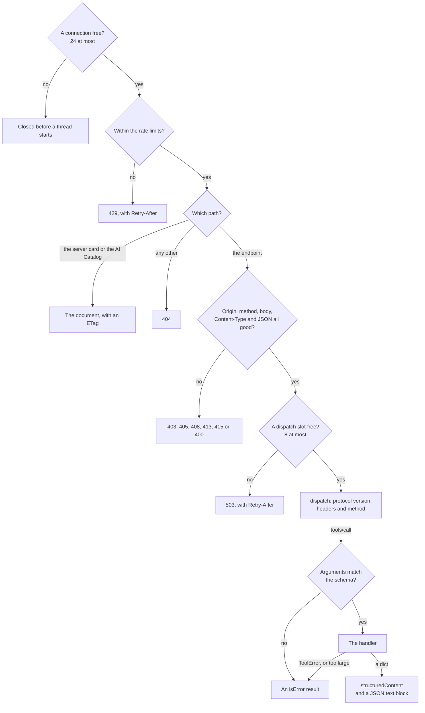

# stdmcp

A Model Context Protocol server toolkit that uses only the Python standard library. It serves read-only tools over Streamable HTTP, and answers both the stateless revision (`2026-07-28`, with `server/discover`) and the handshake revisions (`2025-11-25`, `2025-06-18`, `2025-03-26`). It needs Python 3.10 or later and has no dependencies.

It was written for Floodwatch, but it imports nothing from it. Copy the `stdmcp/` directory, tests included, into another project to reuse it.

## What it does

- Tools only. Every tool is advertised as read-only, idempotent and closed-world.
- One JSON response per POST. A request never opens a stream or a session, and no session ID is issued.
- A small JSON Schema subset for tool arguments: `type` (string, integer, boolean), `pattern`, `minimum`, `maximum`, `enum`, `required`, `default` and `additionalProperties: false`. The schema must be an object, and every property must have one of those three types; a `Tool` whose schema doesn't raises `ValueError` when it is made, so a mistake shows at start rather than letting arguments through unchecked.
- A server card at `<endpoint>/server-card` and an AI Catalog at `/.well-known/ai-catalog.json`.
- Origin checking, connection, request size and concurrency limits, token bucket rate limiting, and one log line per request on stderr.

A request goes through the limits before the protocol, and the protocol before a tool:



## What it leaves out

Sessions, server-sent events, resources, prompts, subscriptions, sampling, and authentication. If you need any of these, put them in front of it (a reverse proxy, for authentication) or use a fuller SDK.

## Example

```python
from stdmcp import App, Tool, ToolError, serve

def add(a: int, b: int) -> dict:
    if a < 0 or b < 0:
        raise ToolError("a and b must not be negative")
    return {"sum": a + b}

app = App(
    name="adder", version="1.0.0", title="Adder", description="Adds two numbers.",
    instructions="Use add to add two non-negative integers.",
    url="https://example.com/mcp",
    tools=(Tool("add", "Add", "Add two integers.",
                {"type": "object", "additionalProperties": False, "required": ["a", "b"],
                 "properties": {"a": {"type": "integer"}, "b": {"type": "integer"}}}, add),),
)
serve(app, "127.0.0.1", 8080, catalog_identifier="urn:example:adder")
```

A handler is called with the validated arguments as keyword arguments and returns a dict, which becomes `structuredContent` and a JSON text block. Raise `ToolError(message)` to return an `isError` result to the model. Invalid arguments also give an `isError` result, as the 2025-11-25 and later specifications require. Any other exception is logged and answered with a generic message.

The endpoint path comes from `App.url` (here `/mcp`; a trailing slash is a 404). `App.url` is the public URL, so it can differ from the host and port being listened on.

Call `server/discover` with the stateless revision:

```sh
curl -s http://127.0.0.1:8080/mcp \
  -H 'Content-Type: application/json' \
  -H 'MCP-Protocol-Version: 2026-07-28' -H 'Mcp-Method: server/discover' \
  -d '{"jsonrpc":"2.0","id":1,"method":"server/discover","params":{"_meta":{"io.modelcontextprotocol/protocolVersion":"2026-07-28"}}}'
```

## Options

`serve(app, host, port, *, catalog_identifier, limits=Limits(), origin_ok=any_https_origin, trust_forwarded=False)`. `make_server` takes the same arguments and returns the server without running it.

- `origin_ok` is called with the `Origin` header value. The default accepts any `https` origin; a request without `Origin` is accepted; `null` and other schemes get a 403.
- `trust_forwarded`: when true and the peer is on loopback (a proxy on the same machine), the client is the last `X-Forwarded-For` entry, provided it is a valid IP address without an IPv6 scope ID. Otherwise the peer address is used. Rate limits and logs use this address.
- `App.max_result_chars` (default 100,000): a larger result becomes an `isError` result.

### Limits

| Field | Default | Meaning |
| --- | --- | --- |
| `max_connections` | 24 | Connections open at once, each with its own thread; beyond this a connection is closed before a thread starts. Keep it above `max_in_flight` and below any limit on the process's threads |
| `max_body` | 65,536 | Largest request body in bytes; a `Content-Length` is required (413 otherwise) |
| `max_in_flight` | 8 | Requests being dispatched at once; more get 503 |
| `per_client` | `(300, 60)` | Per client address: requests per minute, burst size |
| `overall` | `(600, 120)` | All clients together: requests per minute, burst size |

Rate-limited requests get 429 with `Retry-After`. Reading a request body is cut off after 10 seconds (408).

## Specifications

Pinned to these commits:

- [modelcontextprotocol/modelcontextprotocol](https://github.com/modelcontextprotocol/modelcontextprotocol) at `024d5255eb44`: `docs/specification/2026-07-28` and `docs/specification/2025-11-25`
- [modelcontextprotocol/ext-server-card](https://github.com/modelcontextprotocol/ext-server-card) at `28db12c9b4a3`

## Tests

From the repository root:

```sh
python3 -m unittest discover -s stdmcp/tests -t .
```
